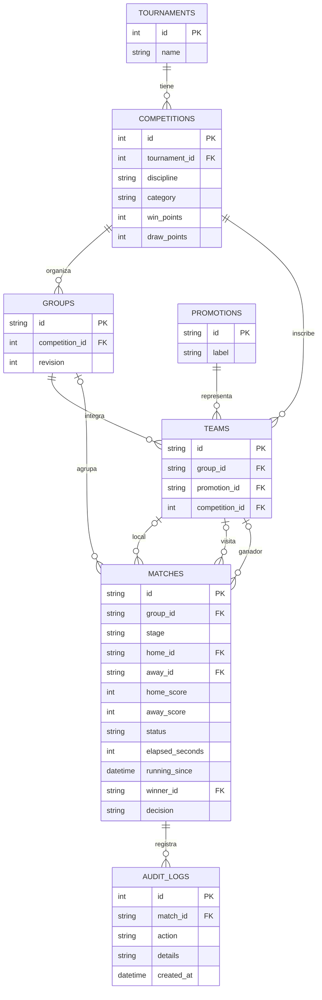

# Modelo de datos

La fuente oficial son los partidos. `GET /api/state` calcula la tabla del grupo a partir de resultados finalizados, separa los puntos provisionales de partidos en juego y entrega las llaves. No se edita una tabla de posiciones independiente.

`MATCHES` contiene además hora, cancha, duración y tantos de penales. El cronómetro suma `elapsed_seconds` con los segundos desde `running_since` solo si está corriendo. Para las rondas de eliminación, `stage` y `position` determinan el siguiente partido: dos posiciones alimentan una posición de la siguiente ronda. El admin asigna manualmente los participantes de octavos hasta confirmar las reglas de clasificación.

Se guarda un registro de las ediciones y controles del administrador en `AUDIT_LOGS`. Las migraciones están en `backend/migrations/versions/`.
